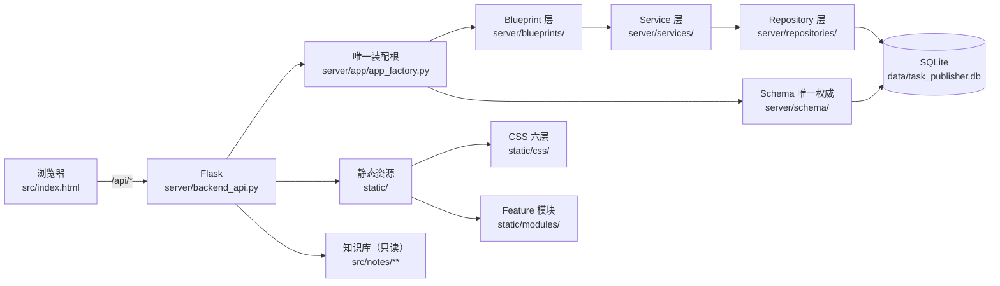

# 超级自动化学习工具

> **一句话定位**：基于 Flask + SQLite 的**本地优先** Web 应用，把 Obsidian 笔记库与
> 「任务抽卡 + 日程/精力追踪」学习系统合在一处，逼迫时间花在真正的思考上。

> **数据不上云**：笔记库（`src/notes/**`）、任务数据库（`data/task_publisher.db`）
> 与运行配置（`config/config.json`）**永不进入版本库**。本仓库只包含代码与文档。

> **本 README 的动态数字**（路由数、文件数、测试数）一律以
> [`docs/CURRENT_PROJECT_STATE.md`](docs/CURRENT_PROJECT_STATE.md) 为准，
> 本文档只做指针，不复制会过期的计数。

---

## 1. 快速开始

**Windows 用户**：双击 `scripts/启动学习工具.bat`

启动链（每一步都会 fail closed，任一步失败即中止）：

```
scripts/启动学习工具.bat
  → scripts/start_web_safe.bat      # 自动建 .venv、装依赖、健康检查
    → scripts/launch_server.py      # 设置项目根为工作目录，写 .run/server.pid
      → server/backend_api.py       # Flask 应用，默认端口 5000
```

> **工作目录不变量**：任何解析项目相对配置（`config/config.json`、`src/notes/**`、
> `data/`）的运行时，**必须以项目根为工作目录**。`launch_server.py` 负责设置。
> `run_app.py` 是**验证 / 迁移入口**，不是产品默认入口。

| 操作 | 命令 |
|---|---|
| 启动 | `scripts/启动学习工具.bat` 或 `scripts/start_web_safe.bat` |
| 停止 | `scripts/stop_web_safe.bat` 或 `scripts/stop_server.py` |
| 备份用户数据 | `scripts/backup_user_data.bat` |

**首次使用**需要本机 Python 3.11+。`start_web_safe.bat` 会创建 `.venv/`
并安装 `requirements-web.txt`。`config/config.json` 不在版本库内，
首次运行会使用内置默认值；需要自定时从 `config/config.example.json` 复制。

---

## 2. 架构速览



**分层职责**

| 层 | 位置 | 职责 |
|---|---|---|
| Schema 唯一权威 | `server/schema/` | 全部 DDL 只允许出现在这一处 |
| 唯一装配根 | `server/app/app_factory.py` | `create_app()`，装配顺序不可调换 |
| Blueprint | `server/blueprints/` | HTTP 路由与请求/响应形状 |
| Service | `server/services/` | 业务规则与事务边界 |
| Repository | `server/repositories/` | SQL 与行映射 |
| 前端内核 | `static/core/` | api / eventBus / router / state / theme / ui |
| Feature 模块 | `static/modules/` | 每个 Feature 一个 owner，闭包持有自身状态 |
| 共享 helper | `static/shared/` | 跨 Feature 的单一实现处 |
| CSS 分层 | `static/css/` | theme → layout → components → features → cards → responsive |

**零构建**：纯 ESM + `<link>`，无 Webpack / Vite / npm 构建步骤。

---

## 3. 目录结构

```
超级自动化学习工具/
├── AGENTS.md                    # Agent 行为规范（唯一权威）
├── README.md                    # 本文件
├── PROJECT_CHANGELOG.md         # 变更台账（顶层台账 + 历史封存）
├── requirements-web.txt         # Web 运行依赖
├── requirements.txt             # 完整依赖
├── run_app.py                   # 验证 / 迁移入口（非产品默认入口）
│
├── server/                      # Flask 后端
│   ├── backend_api.py           # 遗留单体（兼容层，尚未退役，见「已知缺口」）
│   ├── app/                     # 唯一装配根 + bootstrap + config + extensions
│   ├── blueprints/              # 15 个 Blueprint 文件（当前**已注册 8 个**，见第 4 节缺口）
│   ├── services/                # 业务服务层
│   ├── repositories/            # 数据访问层
│   ├── schema/                  # Schema 唯一权威（ensure_all 编排）
│   ├── domain/                  # 领域模型
│   ├── ai/                      # LLM 客户端封装
│   └── utils/                   # 遗留工具（待收敛）
│
├── static/                      # 前端
│   ├── index.html               # 唯一页面（DOM 骨架）
│   ├── app.js                   # classic 全局层（UI 主体）
│   ├── app.entry.js             # ESM 装配根
│   ├── core/  shared/  modules/ # 内核 / 共享 helper / Feature 模块
│   ├── css/                     # 六个扁平分层样式文件
│   └── assets/                  # 美术资源与 Token 覆盖
│
├── src/
│   ├── index.html               # Flask 服务的页面入口
│   ├── tasks/README.md          # 归档路牌（桌面端已移至 _archive/src_tasks_legacy/）
│   └── notes/                   # Obsidian Vault（红线，永不提交）
│
├── scripts/                     # 启停、备份、门禁、验收
├── tests/
│   ├── characterize/            # 行为表征测试
│   ├── e2e/                     # Playwright 规格与配置
│   ├── fixtures/                # 基线数据
│   └── e2e-manual.js            # E2E 入口
│
├── config/
│   └── config.example.json      # 配置模板（config.json 本身是红线）
│
├── .cursor/                     # 红线机械强制器 + 项目规则 + 技能
│   ├── hooks.json
│   ├── hooks/redline-guard.js
│   ├── rules/                   # runtime-cwd / data-redlines
│   └── infra-tests/             # 45 条红线契约用例
│
├── docs/                        # 文档（见 docs/README.md 权威顺序）
│   ├── CURRENT_PROJECT_STATE.md # 唯一现状权威
│   ├── ARCHITECTURE.md          # 运行架构权威
│   ├── README.md                # 导航与权威顺序
│   ├── legacy/tauri/            # 2026-06 Tauri 桌面形态快照
│   └── P1..P5_*                 # AR03 分批交付文档
│
└── _archive/                    # 归档（不进产品路径）
```

> **注意**：`src/notes/**`、`data/task_publisher.db{,-wal,-shm}`、
> `config/config.json` 是**项目红线**，见第 6 节。

---

## 4. 状态与权威

| 想了解 | 看这里 |
|---|---|
| 当前实现状态、基线、**已知缺口** | [`docs/CURRENT_PROJECT_STATE.md`](docs/CURRENT_PROJECT_STATE.md) |
| 运行架构与设计理由 | [`docs/ARCHITECTURE.md`](docs/ARCHITECTURE.md) |
| 文档权威顺序与冲突裁决 | [`docs/README.md`](docs/README.md) |
| 变更历史 | [`PROJECT_CHANGELOG.md`](PROJECT_CHANGELOG.md) |
| Agent 行为规范 | [`AGENTS.md`](AGENTS.md) |
| 归档索引 | [`docs/ARCHIVE_INDEX.md`](docs/ARCHIVE_INDEX.md) |

### 已知缺口（截至 2026-11-27）

AR03 P1–P5 分批重构已入库，但**部分接线未完成**，机械门禁未全绿：

| 项 | 实测症状 | 门禁 |
|---|---|---|
| `server/schema/__init__.py` 未导出 `REQUIRED_TABLES` | `ImportError: cannot import name 'REQUIRED_TABLES'` | `check_schema_consistency.py` **RED** |
| `app_factory` 只注册 9 个 Blueprint（`tasks/gacha/tags/state/timer/schedule/knowledge/feedback`），仓库内实有 15 个 | 门禁期望 `discard/config/index/agent_policy/prompts/agent` 等路由，实得 0；`tasks` 期望 10 实得 9，`gacha` 期望 8 实得 6 | `verify_p0_cleanup.py` **RED** |
| `src/index.html` 未接入 CSS 分层 | 仍有 1 个内联 `<style>`；`<link>` 顺序 `[]`，期望 `[theme, layout, components, features, cards, responsive]`；缺 `sal.theme` 早期同步脚本 | `check_css_architecture.js` **RED**（3 项） |
| `static/app.js` 全局白名单含已不存在的条目 | `window._setCurrentDrawnTask` / `_getCurrentDrawnTask` / `__tasksOwner` 已不存在 | `check_module_imports.js` **RED** |
| `server/backend_api.py` 仍保有 DDL / DML / 路由注册 | 违反 P1 合同「DDL 只允许在 `server/schema/**`」 | 无自动门禁，人工核对 |
| `/api/tasks/21` 出现 1 次 HTTP 500 | 请求方法未确定，根因未确认 | **已知限制，未结案** |

已通过的门禁：`check_layout_utility_conflicts.js`（143 类、0 冲突）、
`phase2_gacha_golden.py`（max_diff=0）。

> 逐项归因、实测证据与修复方向见各 P 分批 commit message 与
> `docs/P5_FINAL_DELIVERY_REPORT_20261122.md`。

---

## 5. 测试与门禁

```bash
# 机械门禁
node scripts/check_module_imports.js          # 模块边界
node scripts/check_css_architecture.js         # CSS 架构 6 道
node scripts/check_layout_utility_conflicts.js # 布局类冲突
python scripts/check_schema_consistency.py     # Schema 唯一权威
python scripts/verify_p0_cleanup.py            # legacy 收敛与路由核对
python scripts/phase2_gacha_golden.py          # 抽卡黄金快照
python scripts/route_inventory.py              # 路由清单

# 行为表征
python -m pytest tests/characterize -q

# E2E（隔离运行，全程不触碰生产数据）
$env:PYTHON="$PWD\.venv\Scripts\python.exe"   # 必须显式指向 venv
node scripts/run_e2e_isolated.js
```

> **`PYTHON` 必须显式指向 `.venv` 解释器**，否则子进程以 `code=9009` 退出。

**数据安全**：E2E 走 `scripts/run_e2e_isolated.js` —— Node fs 守卫（事前阻断）
+ Python `sys.addaudithook` 审计（事中）+ 合成根自检（fail closed）三重机制，
**全程不打开生产文件**。`scripts/guard/protected_paths_guard.js` 是独立的
生产数据隔离守卫。

---

## 6. 数据与红线

以下路径是**项目红线**，任何情况下都不得进入版本库：

| 路径 | 内容 | 强制层 |
|---|---|---|
| `src/notes/**` | 本地 Obsidian 知识库（用户私有数据） | `.gitignore` + CI `redline-scan` + `.cursor/hooks/redline-guard.js` |
| `data/task_publisher.db{,-wal,-shm}` | 实时应用数据库（WAL 家族） | 同上 |
| `config/config.json` | 运行配置（含密钥与路径） | 同上 |

**红线是仓库属性，不是本机约定**：

- **L1 声明** — `.gitignore`、`AGENTS.md`、`.github/CONTRIBUTING.md`、`.github/SECURITY.md`
- **L2 仓库** — CI `redline-scan` job：扫描 PR 三点 diff **与** `git ls-files`
  （能发现「先加后删」绕过）
- **L3 强制** — `main` 分支保护：禁止直推，`ci/gates` + `ci/redline-scan` 必过
- **L4 本地** — `.cursor/hooks/redline-guard.js`（`preToolUse`，fail closed）
  + `scripts/guard/protected_paths_guard.js`

> `.cursor/infra-tests/redline-guard/` 内含 45 条契约用例，
> 是红线行为的**可执行说明**。

---

## 7. 参与方式

| 事务 | 载体 | 编号 | 模板 |
|---|---|---|---|
| 里程碑提案 | GitHub Issue | `[M-<ID>]` | `.github/ISSUE_TEMPLATE/milestone-proposal.md` |
| 想法 | GitHub Issue | `[IDEA]` | `.github/ISSUE_TEMPLATE/idea.md` |
| 圆桌会议 | GitHub Issue | `[RT-<YYYYMMDD>-<nn>]` | `.github/ISSUE_TEMPLATE/roundtable.md` |
| 独立验收 | GitHub Issue | `[AUDIT]` | `.github/ISSUE_TEMPLATE/audit.md` |

- 里程碑编号沿用 `M01`–`M05`；`AR03` 是已完成的工程批次。
- 圆桌规范见 [`docs/ROUNDTABLE_PROTOCOL.md`](docs/ROUNDTABLE_PROTOCOL.md)。
- 外部写操作（Issue / PR / API 写）必须记入
  [`docs/external-write-log.md`](docs/external-write-log.md)。
- PR 需通过第 5 节的全部门禁；提交粒度与 tag 约定见
  [`.github/CONTRIBUTING.md`](.github/CONTRIBUTING.md)。

---

## 8. 相关分支

| 分支 | 内容 |
|---|---|
| `main` | **产品线**（本分支，Flask + SQLite 本地 Web 应用） |
| `master` | 2026-06 的 Tauri v2 + React + Rust 桌面形态历史（已废弃，保留供追溯） |

两者**无共同祖先**，从未合并，也不应合并。`master` 的独有文档资产已抢救至
`docs/legacy/tauri/`。

---

## 许可

见 [`LICENSE`](LICENSE)（尚未添加；见 `docs/CURRENT_PROJECT_STATE.md` 的待决项）。
