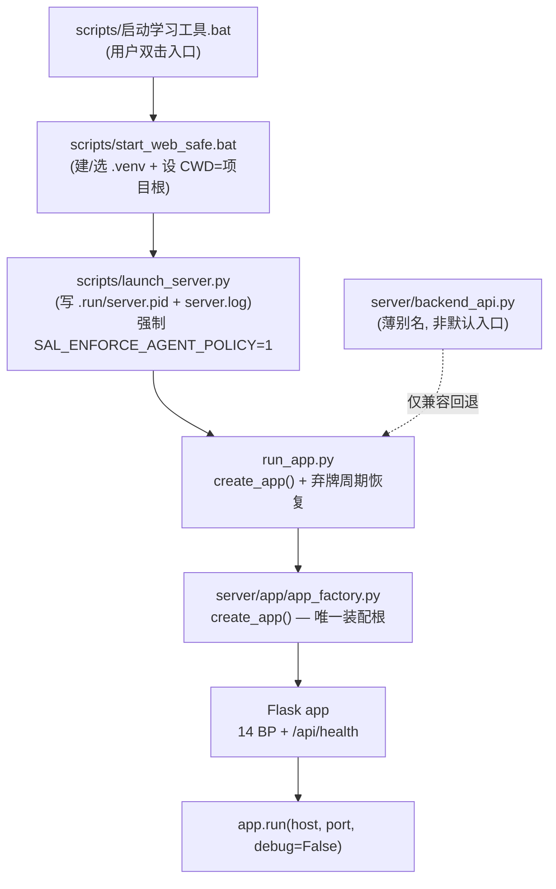
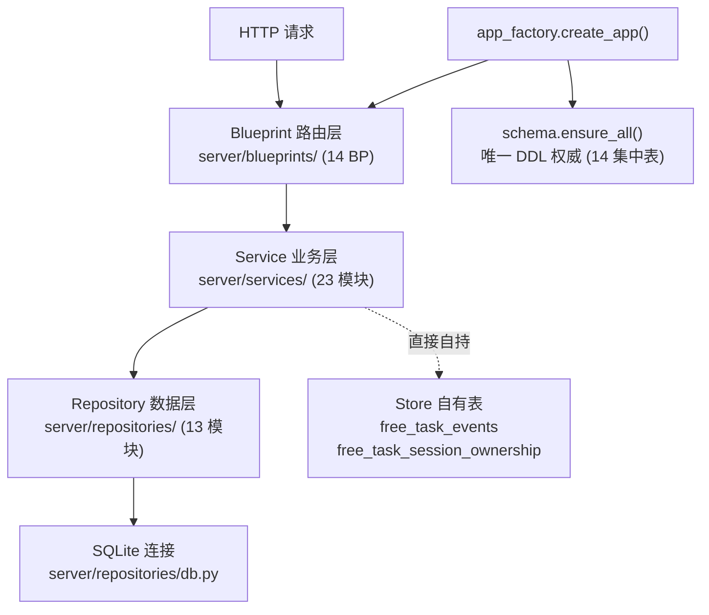
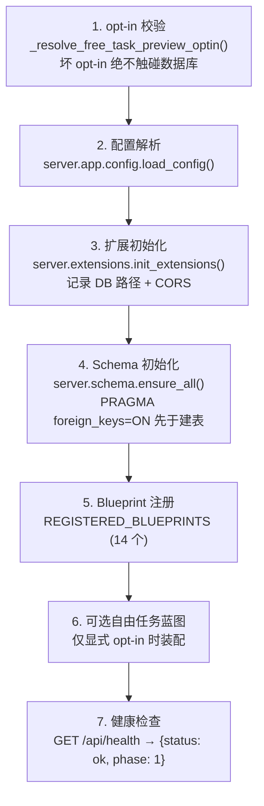
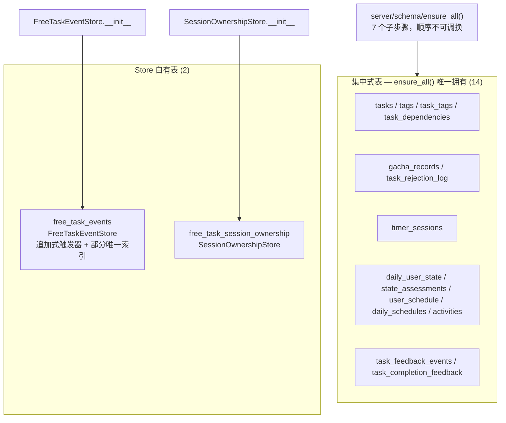
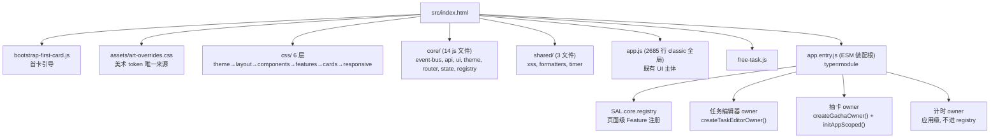

# Architecture

> **本文是当前运行系统的实现架构权威描述。** 上一版（2026-10-04 快照）
> 已归档到 [`docs/architecture/2026-10-04_snapshot.md`](architecture/2026-10-04_snapshot.md)，
> 其中的 "42 路 legacy + 5 BP"、"backend_api 是默认入口" 等表述 **已全部失效**，
> 不得再作为事实引用。
>
> 配套文档：当前健康状态 / 基线 / 下一步见
> [`docs/CURRENT_PROJECT_STATE.md`](CURRENT_PROJECT_STATE.md)；
> P5 阶段交付证据见
> [`docs/P5_FINAL_DELIVERY_REPORT_20261122.md`](P5_FINAL_DELIVERY_REPORT_20261122.md)。
>
> **口径**：本文中的所有数量均为 **实测值**（由
> `server.app.create_app()` 实例化后统计 `url_map` 与
> `server.schema.REQUIRED_TABLES` 得出），快照日期 **2026-11-23**。

---

## System Purpose

**超级自动化学习工具** 不是 Todo 列表，也不是一个番茄钟。它是一个
**闭环学习系统**，AI 是 **辅助层**，而不是决策权威。

核心循环：

```text
plan
  → task pool
    → intelligent / gacha selection
      → execute
        → timer
          → feedback
            → state
              → knowledge accumulation
```

把它读成 **环**，而不是漏斗。执行结果回流到状态评估（精力、当日语气、睡眠），
状态又影响下一次抽取；完成的工作沉淀为 Obsidian 知识库文件；
知识库再反哺规划。

由此产生两条设计承诺，解释了代码里的大部分取舍：

1. **抽取是加权而非任意的。** 抽卡按精力成本、抵触度、稀有度、优先级与
   近期抽取状态对候选任务打分。因此 `server/services/gacha.py` 是 **产品行为
   承重墙**，不是附带代码 —— 它由 golden 测试锁定。
2. **知识以文件而非行累积。** 知识库是长期记忆；数据库存运营状态，
   文件系统存知识。

### AI 实际在哪里

AI 只在两处 **辅助**：从原始素材导入任务，以及 Agent 面板遍历知识库起草笔记。
**抽卡核心逻辑是确定性的权重计算**，不是模型决策。任何"AI 驱动核心循环"
的说法都是错的。

---

## Runtime Architecture

### 启动链



**关键事实**：默认生产链 **不再经过** `server/backend_api.py`。
`run_app.py` 直接 `from server.app import create_app`，并直接调用
`server.services.discard.recover_discard_cycle()`，因此生产启动不依赖 legacy
薄别名。`server/backend_api.py` 保留为兼容别名，其启动脚本 `start_web_legacy.bat`
已归档。

`launch_server.py::select_entrypoint` 保留 `factory` / `legacy` 两个分支，
但 `main()` 在 `legacy` 模式下 **fail closed** 拒绝启动（legacy 后端没有
服务端 bootstrap 闸门）。

### 后端分层



依赖方向单向向下：`blueprints → services → repositories`。
`repositories` **不** 依赖 Flask；`blueprints` 不反向依赖 `app_factory`。
少量 service（自由任务事件 / 会话归属）**自持表**，因为它们带追加式触发器
与部分唯一索引语义，由拥有者自己建表才不会被破坏。

### 当前数量（实测，2026-11-23）

| 项 | 数量 |
|---|---|
| 注册蓝图（`REGISTERED_BLUEPRINTS`） | **14**（另有可选的 `free_task_bp`，默认不装配） |
| 总路由 | **82**（80 条 API + `GET /api/health` + Flask `/static/<path>`） |
| Service 模块 | **23** |
| Repository 模块 | **13** |
| 集中式表（`ensure_all()` 拥有） | **14** |
| Store 自有表 | **2** |
| CSS 层 | **6** |
| 前端 `core/` js 文件 / `shared/` js 文件 / `modules/` 目录 | 14 / 3 / 11 |

路由按蓝图分布：

| 蓝图 | 路由数 | 蓝图 | 路由数 |
|---|---|---|---|
| `state_bp` | 11 | `tags_bp` | 4 |
| `tasks_bp` | 10 | `discard_bp` | 3 |
| `knowledge_bp` | 9 | `config_bp` | 3 |
| `agent_bp` | 9 | `feedback_bp` | 3 |
| `gacha_bp` | 8 | `index_bp` | 1 |
| `schedule_bp` | 8 | `agent_policy_bp` | 1 |
| `timer_bp` | 5 | app 级 | 2 |
| `prompts_bp` | 5 | | |

### `create_app()` 装配顺序（7 步，逐步 fail closed）



第 1 步刻意排在 Flask app 构造、`get_db_connection()` 与任何目录扫描 **之前**：
畸形 opt-in 既不读 `config/config.json`，也不打开普通数据库，更不会留下
"已创建但半装配" 的 app。

第 4 步在 `ensure_all()` **之前**执行 `PRAGMA foreign_keys=ON` —— 否则
SQLite 默认关闭外键约束，`FOREIGN KEY` 子句会被静默忽略并产生孤儿引用。

第 6 步是 **默认关闭** 的自由任务受保护预览：`enable` / `store` /
`authorizer` **只**来自调用实参，绝不从环境变量、配置文件或默认 `data/`
路径推断。默认 app 的 `url_map` 中 **不存在** `/api/free-tasks`。

### `/api/health` 契约

权威响应形状（逐键不变）：

```json
{"status": "ok", "phase": 1}
```

契约由 `tests/characterize/test_health_contract.py` 锁定。
启动链只依赖 HTTP 200，不解析响应体。

---

## 数据层：Schema 归属



### 归属规则（机械门禁强制）

- **14 张集中表** 的 DDL **只能**出现在 `server/schema/` 内，且 **只能**由
  `ensure_all()` 产出。其它任何位置出现 `CREATE TABLE` 都是违规。
- **2 张 Store 自有表** 由各自的 Store 在构造时建表；`ensure_all()`
  **不**创建它们（否则会破坏追加语义）。
- `ensure_all()` 的硬保证：**空库可成功**、**幂等**（连跑两次产出完全一致）、
  **不破坏数据**（只用 `CREATE TABLE IF NOT EXISTS` 与
  `ALTER TABLE ... ADD COLUMN`）。

`ensure_all()` 内部顺序（**不可调换**）：`tasks` → `gacha` → `timer` →
`state` → `feedback` → `notes` → `indexes`。第 2–5 步的表都有指向
`tasks(id)` 的外键，所以 `tasks` 必须最先建立；索引依赖 `tasks` /
`task_tags`，必须最后建立。

### Schema 一致性门禁

`scripts/check_schema_consistency.py`（只读脚本，退出码 0 = 全绿）执行 8 项检查：

| 编号 | 检查 |
|---|---|
| C1 | `REQUIRED_TABLES` 完整性：14 张集中表全部由 `ensure_all()` 在空库上产出 |
| C2 | 14+2 归属：两张专用表由各自 Store 创建，`ensure_all()` 不创建 |
| C3 | 域覆盖：五域模块的表归属无遗漏、无重复 |
| C4 | 未授权重复 DDL：AST 扫描 `server/**`，`CREATE TABLE` 必须落在白名单内 |
| C5 | 幂等：`ensure_all()` 连跑两次 → 表/列/索引集合完全一致 |
| C6 | 空库可初始化：临时 SQLite 上 `ensure_all()` 成功 |
| C7 | 实际表集合 ⊇ 权威定义 |
| C8 | 数据保全：既有行不被删、旧列不被改 |

---

## 前端架构

### 加载顺序与装配根



`app.entry.js` 是 **唯一** 的模块装配入口。它承担三件事：

1. **页面级 Feature 注册** —— 把 `modules/*` 的 `default` 导出（契约
   `{meta, mount(rootEl, ctx), unmount(rootEl)}`）注册进 `SAL.core.registry`。
   注册 **fail closed**：契约不完整（缺 `meta` / `mount` / `unmount`）
   就跳过并报错，绝不"半注册"。**应用级模块绝不进 registry** ——
   否则页面切换会把它们 unmount 掉。
2. **owner 唯一化** —— 任务编辑器 owner、抽卡 owner 在模块入口执行阶段
   （classic `app.js` 已执行、用户交互尚未开始）同步创建 **唯一** 实例，
   并把既有同步入口名（`window.openTaskEdit` / `window.drawGacha` / …）
   绑定到 owner 上。`src/index.html` 的 inline handler 依赖这些全局，
   因此 **刻意不用** 动态 `import()`。
3. **诊断报告** —— 打印一次 core + shared 完整性报告。

**依赖注入而非窗口偷查**：owner 的所有依赖（`api` / `toast` / `showModal` /
`escapeHtml` / `normalizeCardType` / 数据 getter / 既有行为函数）都从
classic 层 **显式读取并注入**，owner 内部不通过 `window` 反查私有依赖。
classic 层是这些依赖的 **唯一实现**，数据源用 getter 注入而非复制数组。

### CSS 6 层

| 层 | 文件 | 职责 |
|---|---|---|
| 1 | `theme.css` | 设计 token；`:root` / `:root[data-theme=…]` **只允许** 出现在此 |
| 2 | `layout.css` | 骨架与栅格 |
| 3 | `components.css` | 通用组件（模态、按钮等） |
| 4 | `features.css` | 功能域样式 |
| 5 | `cards.css` | 卡牌层；`--card-*` **只允许**在此定义 |
| 6 | `responsive.css` | 响应式与 reduced-motion |

加载顺序 **必须** 是 `theme→layout→components→features→cards→responsive`，
由 `scripts/check_css_architecture.js` 机械校验（连同 token 所有权、
选择器唯一归属、9 个语义变量的 dark/light 双向定义、源序等价性）。

`--art-*` token 的 **定义** 只允许来自 `static/assets/art-overrides.css`；
`cards.css` / `features.css` 只能 **消费**。

### 无障碍：reduced-motion

`prefers-reduced-motion: reduce` 下，卡牌动画 **不** 依赖 `animationend`
事件，而是由 JS `setTimeout` 状态机驱动；`0.01ms` 的 duration 保留了
派发能力而不把逻辑与 CSS 解耦。回归由
`tests/e2e/reduced-motion-regression.spec.js` 锁定（`pointer-events: auto`
恢复、`playCardAnim` promise 不阻塞、零重复提交）。

---

## 目录结构

```text
.
├── run_app.py                  # Factory 入口（默认生产）
├── server/
│   ├── app/                    # 装配根：app_factory / config / extensions / bootstrap
│   ├── blueprints/             # 14 个路由蓝图
│   ├── services/               # 23 个业务模块
│   ├── repositories/           # 13 个数据访问模块
│   ├── schema/                 # 唯一 DDL 权威（14 集中表）
│   ├── domain/                 # 领域模型
│   ├── ai/                     # LLM 客户端与提示词
│   └── backend_api.py          # 薄别名（非默认入口）
├── static/
│   ├── app.entry.js            # ESM 装配根
│   ├── app.js                  # classic 全局 UI
│   ├── core/ shared/ modules/  # 前端内核 / 共享 / 业务模块
│   └── css/                    # 6 层
├── scripts/                    # 启动器与机械门禁
├── tests/
│   ├── characterize/           # 刻画测试套件
│   └── e2e/                    # Playwright 端到端
├── docs/                       # 架构与交付文档
└── _archive/                   # 归档批次 01–11（见 docs/ARCHIVE_INDEX.md）
```

---

## 治理门禁

以下脚本是 **只读** 的机械门禁，退出码 0 = 全绿：

| 脚本 | 约束 |
|---|---|
| `scripts/check_css_architecture.js` | CSS 6 层顺序、token 所有权、选择器唯一归属、语义变量双向定义、源序等价 |
| `scripts/check_layout_utility_conflicts.js` | 布局/工具类命名冲突 |
| `scripts/check_module_imports.js` | 前端模块导入方向（内核不 import 业务模块） |
| `scripts/check_schema_consistency.py` | 14+2 schema 归属（见上文 C1–C8） |
| `scripts/verify_p0_cleanup.py` | P0 清理断言 |
| `scripts/phase2_gacha_golden.py` | 抽卡 golden 回归（`max_diff` 必须为 0） |

端到端：

- `tests/e2e-manual.js` —— 36 项手工流程 E2E，**必须**经
  `node scripts/run_e2e_isolated.js` 运行（合成服务器 + 生产数据 fs 守卫
  + 访问审计）。直接跑会触碰生产数据。
- `tests/e2e/reduced-motion-regression.spec.js` —— reduced-motion 回归。

---

## 数据红线

以下路径 **不可** 被 Cursor 修改：

- `src/notes/**` —— Obsidian 知识库，本地用户数据
- `data/task_publisher.db`（含 `-wal` / `-shm`）
- `config/config.json` —— 含密钥与路径的运行时配置

政策见 `.cursor/rules/data-redlines.mdc`。`.cursor/hooks/redline-guard.js`
是纵深防御，不等于覆盖了每一个原生编辑面。

---

## 与历史快照的关系

| 文档 | 状态 |
|---|---|
| `docs/ARCHITECTURE.md`（本文） | **当前权威** |
| `docs/architecture/2026-10-04_snapshot.md` | 历史快照，已过期，仅供追溯 |
| `docs/CURRENT_PROJECT_STATE.md` | 当前状态与基线 |

上一版快照描述的是 "42 路 legacy + 5 BP、backend_api 是默认入口、
Factory 仅作验证入口" 的世界 —— 那条路已经走完：**legacy 路由已清零，
兼容桥已归档到 `_archive/`，14 个蓝图全部注册，生产入口是 `run_app.py`。**
